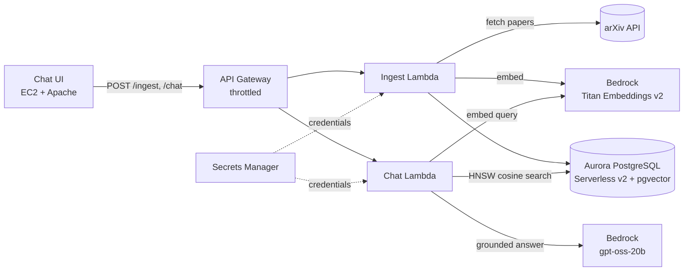

# Serverless RAG Research Assistant

A serverless retrieval-augmented generation (RAG) system on AWS for searching and asking questions about arXiv research papers. Papers are fetched from the arXiv API, embedded with Amazon Titan Text Embeddings v2, stored in Aurora PostgreSQL with pgvector, and answered by an OpenAI gpt-oss model on Amazon Bedrock with source citations. All infrastructure is defined in AWS CDK (TypeScript).

## Architecture



- **Network:** VPC with public, private (Lambdas, egress via NAT), and isolated (database) subnets. The database accepts connections only from the Lambda security group.
- **Ingestion:** fetches papers from arXiv, deduplicates by arXiv ID, embeds title + abstract (1024 dimensions, normalized), and stores one vector per paper.
- **Retrieval:** cosine nearest-neighbour search over an HNSW index, optionally filtered by topic. Similarity is reported as `1 − cosine distance`.
- **Generation:** the top results are passed to gpt-oss-20b with instructions to answer only from the sources and cite them as `[Source N]`.
- **Observability:** OpenTelemetry metrics from both Lambdas go through an OTel Collector to Prometheus, with Grafana dashboards for traffic, errors and latency, two SLOs (99.5% success, p95 < 4 s) with multi-window burn-rate alerts, and an external blackbox_exporter uptime probe on `GET /health`. CloudWatch alarms cover Lambda errors and throttles and API Gateway 5XX and p95 latency. Each chat response also includes per-stage timings and token usage. See [monitoring/README.md](monitoring/README.md).

## Repository layout

```
common/            Shared Python code (Bedrock, database, HTTP helpers), copied into each Lambda at synth time
lambda_ingest/     POST /ingest handler
lambda_chat/       POST /chat handler
infrastructure/    AWS CDK stack (TypeScript)
chat_ui/           Static web interface
monitoring/        OTel Collector, Prometheus SLO rules, Grafana dashboards, Alertmanager, blackbox_exporter
eval/              Retrieval evaluation (metrics, runner, eval-set template)
tests/             Unit tests (run offline, no AWS needed)
scripts/           Lambda layer build script
```

## Deploy

Prerequisites: an AWS account with Bedrock access to `amazon.titan-embed-text-v2:0` and `openai.gpt-oss-20b-1:0` in your region, the AWS CLI configured, Node.js 18+, and Python 3.11+.

```bash
git clone https://gitlab.com/mukeshethiraj0/serverlessrag.git
cd serverlessrag
./deploy.sh
```

`deploy.sh` builds the Lambda dependency layer, installs CDK dependencies, bootstraps CDK, deploys the stack, and prints the API and Chat UI URLs.

Optional settings are passed as CDK context:

| Setting | Default | Purpose |
| --- | --- | --- |
| `allowedOrigin` | `*` | CORS origin, e.g. your Chat UI URL |
| `throttleRate` / `throttleBurst` | `5` / `10` | API Gateway requests per second and burst |
| `uiRepoUrl` | this repo | Git repo the Chat UI and monitoring instances clone |
| `monitoring` | `false` | `true` adds the Prometheus/Grafana monitoring instance (see [monitoring/README.md](monitoring/README.md)) |
| `monitoringAllowedCidr` | none | CIDR allowed to open Grafana on port 3000; unset means Session Manager only |
| `alarmEmail` | none | Email subscribed to CloudWatch alarm notifications |

```bash
./deploy.sh -c allowedOrigin=http://ec2-1-2-3-4.compute-1.amazonaws.com
```

**Cost note:** Aurora Serverless v2 and the NAT gateway bill while the stack is running. Destroy it when you're done:

```bash
cd infrastructure && npx cdk destroy ServerlessRagStack
```

Shell access to the UI instance is through AWS Systems Manager Session Manager; no SSH port is open.

## API

### `POST /ingest`

```bash
curl -X POST "$API/ingest" -H "Content-Type: application/json" \
  -d '{"query": "retrieval augmented generation", "max_results": 20, "topic_name": "RAG"}'
```

| Field | Required | Notes |
| --- | --- | --- |
| `query` | yes | arXiv search terms |
| `max_results` | no | 1–50, default 10 |
| `topic_name` | no | defaults to the query in title case |

Returns `inserted_count`, `skipped_duplicates`, `failed_count`, `elapsed_ms`, and the list of fetched papers.

### `GET /health`

Runs `SELECT 1` through API Gateway, Lambda and the database. Returns `{"status": "ok"}` or a 503. Used by the uptime probe.

### `POST /chat`

```bash
curl -X POST "$API/chat" -H "Content-Type: application/json" \
  -d '{"query": "How does retrieval reduce hallucination?", "topic": "RAG", "top_k": 5}'
```

| Field | Required | Notes |
| --- | --- | --- |
| `query` | yes | up to 1000 characters |
| `topic` or `topic_id` | no | restricts search to one topic |
| `top_k` | no | 1–20, default 5 |
| `retrieval_only` | no | `true` skips the LLM call (used for evaluation) |

```json
{
  "response": "Retrieval grounds the model in source text ... [Source 1]",
  "sources": [
    {"paper_title": "...", "arxiv_id": "2005.11401v4", "similarity": 0.6123, "url": "https://arxiv.org/abs/2005.11401v4"}
  ],
  "num_sources": 5,
  "timings_ms": {"embedding_ms": 85.2, "retrieval_ms": 9.8, "generation_ms": 2140.5, "total_ms": 2241.7},
  "usage": {"prompt_tokens": 1450, "completion_tokens": 210}
}
```

Errors return a generic message and the Lambda request ID; details are logged to CloudWatch only.

## Evaluation

Retrieval quality is measured against a hand-labeled question set.

1. **Ingest papers** for a few topics and save the responses:
   ```bash
   curl -s -X POST "$API/ingest" -H "Content-Type: application/json" \
     -d '{"query": "retrieval augmented generation", "max_results": 20, "topic_name": "RAG"}' > eval/ingest_rag.json
   ```
2. **Build a template** with one row per ingested paper:
   ```bash
   python eval/make_eval_template.py eval/ingest_*.json -o eval/eval_set.jsonl
   ```
3. **Write one question per paper** in the `question` field. Describe what the paper does in your own words; don't copy phrases from the title, or the test becomes keyword matching. Aim for 30–50 questions.
4. **Run the evaluation:**
   ```bash
   # Retrieval quality (no LLM calls)
   python eval/run_eval.py --api "$API" --eval-set eval/eval_set.jsonl --mode retrieval

   # Harder: search across all topics
   python eval/run_eval.py --api "$API" --eval-set eval/eval_set.jsonl --mode retrieval --ignore-topic

   # End-to-end latency, tokens, and LLM cost (prices in USD per 1K tokens from the Bedrock pricing page)
   python eval/run_eval.py --api "$API" --eval-set eval/eval_set.jsonl --mode full \
     --input-price <input_price> --output-price <output_price>
   ```

The runner reports hit rate@1/3/5, MRR@5, recall@5, client and server latency (p50/p95), average token usage, and LLM cost per query, and writes JSON and Markdown reports to `eval/results/`. It uses only the Python standard library.

### Results

_Run the evaluation and record the numbers here._

| Metric | Topic-filtered | All topics |
| --- | --- | --- |
| Questions | | |
| Hit rate@1 | | |
| Hit rate@5 | | |
| MRR@5 | | |
| Retrieval latency p95 (server) | | |
| End-to-end latency p50 / p95 | | |
| LLM cost per query | | |

## Tests

```bash
pip install -r requirements-dev.txt
pytest -q
```

The tests run offline with the AWS SDK stubbed. They cover arXiv parsing, input validation, the similarity calculation, context building, deduplication, error handling, parameter binding, and the evaluation metrics.

## Design notes and limitations

- **One vector per paper.** Retrieval is at the title + abstract level, which suits finding the right paper. Answers about details inside a paper's full text would need PDF chunking.
- **HNSW over IVFFlat.** IVFFlat learns its clusters from the rows present when the index is built, so building it on an empty table gives poor recall. HNSW needs no training and stays accurate as papers are added.
- **Security.** The API has no authentication and relies on stage throttling; add an API key with a usage plan, or Cognito, before sharing it publicly. The Chat UI is served over HTTP; put CloudFront with HTTPS in front for production.

## License

MIT
