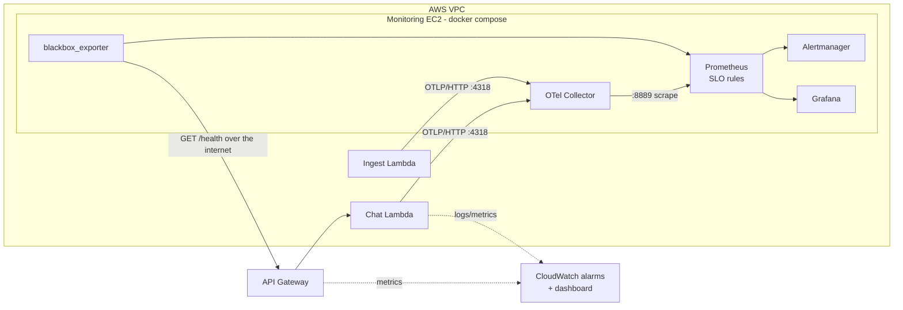

# Monitoring: OpenTelemetry, Prometheus, Grafana, SLOs



- **Instrumentation** (`common/telemetry.py`): the OpenTelemetry SDK records request latency and status per route, per-stage latency (embedding, retrieval, generation), LLM tokens and cold starts. Lambda freezes the container when the handler returns, so the meter provider is force-flushed at the end of every invocation. With no `OTEL_EXPORTER_OTLP_ENDPOINT` set, telemetry is a no-op.
- **Collector** (`otel-collector.yaml`): receives OTLP/HTTP and exposes Prometheus metrics. Each Lambda container reports its own series (`instance` label); queries sum across them.
- **Prometheus** (`prometheus/`): scrapes the collector and blackbox_exporter, evaluates SLO recording and burn-rate alerting rules, keeps 35 days (the SLO window is 30).
- **Grafana** (`grafana/`): two provisioned dashboards, *RED* and *SLOs and error budgets*.
- **Uptime** (`blackbox/`): blackbox_exporter calls `GET /health` on the public API URL every 30 s, the way a client would. `/health` runs `SELECT 1` through API Gateway, Lambda and Aurora, with no Bedrock cost.
- **CloudWatch** (in the CDK stack, always on): alarms on Lambda errors and throttles and on API Gateway 5XX rate and p95 latency, plus a CloudWatch dashboard. These catch what in-process metrics cannot: a Lambda that times out or runs out of memory never reaches its flush, and API Gateway 429s never reach the Lambda.

## Metrics

| Prometheus name | Type | Labels |
| --- | --- | --- |
| `rag_request_duration_seconds` | histogram | `route`, `method`, `status_code`, `status_class` |
| `rag_stage_duration_seconds` | histogram | `route`, `stage` (`embedding`, `retrieval`, `generation`) |
| `rag_llm_tokens_total` | counter | `type` (`prompt`, `completion`) |
| `rag_cold_starts_total` | counter | |
| `probe_success`, `probe_duration_seconds` | gauge | blackbox_exporter |

## SLOs

| SLO | Objective | SLI | Error budget (30 days) |
| --- | --- | --- | --- |
| `chat-availability` | 99.5% | `POST /chat` responses that are not 5xx | 0.5% of requests (about 3.6 hours of total outage) |
| `chat-latency` | 95% under 4 s (p95 < 4 s) | successful `POST /chat` requests faster than 4 s | 5% of successful requests |

4xx responses are client errors and do not count against availability. `/ingest` is a batch admin call with a 15-minute timeout, so it is on the dashboards but not in the SLOs.

Rules are generated by `prometheus/generate_slo_rules.py` (edit the `SLOS` list, then run it). To change the latency threshold, pick a value that is a bucket boundary in `LATENCY_BUCKETS_S`. Set the threshold from a week of real data, a little above your measured p95.

### Burn-rate alerts

Multi-window, multi-burn-rate alerts from the Google SRE Workbook. Both windows must exceed the threshold, so alerts fire fast on big incidents and clear soon after recovery.

| Severity | Burn rate | Long / short window | Budget spent when it fires | Availability threshold | Latency threshold |
| --- | --- | --- | --- | --- | --- |
| page | 14.4x | 1h / 5m | 2% | 7.2% errors | 72% slow |
| page | 6x | 6h / 30m | 5% | 3% | 30% |
| ticket | 3x | 1d / 2h | 10% | 1.5% | 15% |
| ticket | 1x | 3d / 6h | 10% | 0.5% | 5% |

`prometheus/tests/slo_test.yml` unit-tests these with `promtool test rules` (healthy traffic, a 10% error outage, a slow-model incident). Other alerts (`rules/alerts.yml`): uptime probe failing, slow probe, TLS certificate expiry, collector down.

Alertmanager routes `severity=page` and `severity=ticket` to separate receivers and lets a page suppress the matching ticket. Add a Slack, email or webhook receiver in `alertmanager/alertmanager.yml`.

## Deploy on AWS

```bash
./deploy.sh -c monitoring=true -c monitoringAllowedCidr=$(curl -s https://checkip.amazonaws.com)/32 -c alarmEmail=you@example.com
```

This adds a `t3.small` instance in a public subnet (about $15/month plus a 20 GB disk) that installs Docker, clones this repo and runs `setup.sh` with the API URL. Lambdas get `OTEL_EXPORTER_OTLP_ENDPOINT` pointing at its private IP; only the Lambda security group can reach port 4318. Confirm the SNS email subscription to receive CloudWatch alarms.

Grafana is on port 3000 of the instance, open only to `monitoringAllowedCidr`. User `admin`; the password is in Secrets Manager:

```bash
aws secretsmanager get-secret-value --secret-id <GrafanaPasswordSecret output> --query SecretString --output text
```

Without `monitoringAllowedCidr`, nothing is exposed. Reach Grafana through Session Manager instead:

```bash
aws ssm start-session --target <MonitoringInstanceId output> \
  --document-name AWS-StartPortForwardingSession --parameters '{"portNumber":["3000"],"localPortNumber":["3000"]}'
# then open http://localhost:3000 (same for 9090 Prometheus, 9093 Alertmanager)
```

Setup log on the instance: `/var/log/monitoring-setup.log`.

## Run locally

```bash
cd monitoring && ./setup.sh http://host.docker.internal:8000/    # Grafana on http://localhost:3000
cd .. && pip install -r requirements-layer.txt
OTEL_EXPORTER_OTLP_ENDPOINT=http://localhost:4318 python3 scripts/local_api.py --fake --error-rate 0.01
python3 scripts/load_test.py --api http://localhost:8000 --rps 2 --minutes 10
```

`--fake` simulates Bedrock and the database (latencies and errors are made up) to check dashboards and alerts. Drop `--fake` and set `LOCAL_DEV=1` plus `DB_*` variables to run the real handlers against Bedrock and a local pgvector database.

## Get your numbers

After the deployed stack has served real traffic (your own use, `eval/run_eval.py`, or `scripts/load_test.py`):

```bash
python3 scripts/slo_report.py --prometheus http://localhost:9090 --window 7d
```

It prints request count, success rate, p50/p95/p99, per-stage p95, tokens, uptime-probe success and error budget left, all from Prometheus, and drafts a resume bullet from them. It refuses to report on fewer than 200 requests.

## Design notes

- **Why the Lambdas push instead of being scraped:** Lambda containers are short-lived and unreachable, so Prometheus cannot scrape them. OTLP push to a collector is the standard pattern. The AWS Distro for OpenTelemetry Lambda layer is an alternative that flushes from a Lambda extension instead of the handler.
- **Flush cost:** `force_flush` adds one small HTTP POST inside the VPC to each invocation, with a 2 s exporter timeout so a collector outage cannot stall requests for long. It is not counted in the recorded latency.
- **Blind spots and their cover:** a request that kills the Lambda before the flush, or is throttled by API Gateway, never emits a metric. The CloudWatch alarms and the external uptime probe cover those cases.
